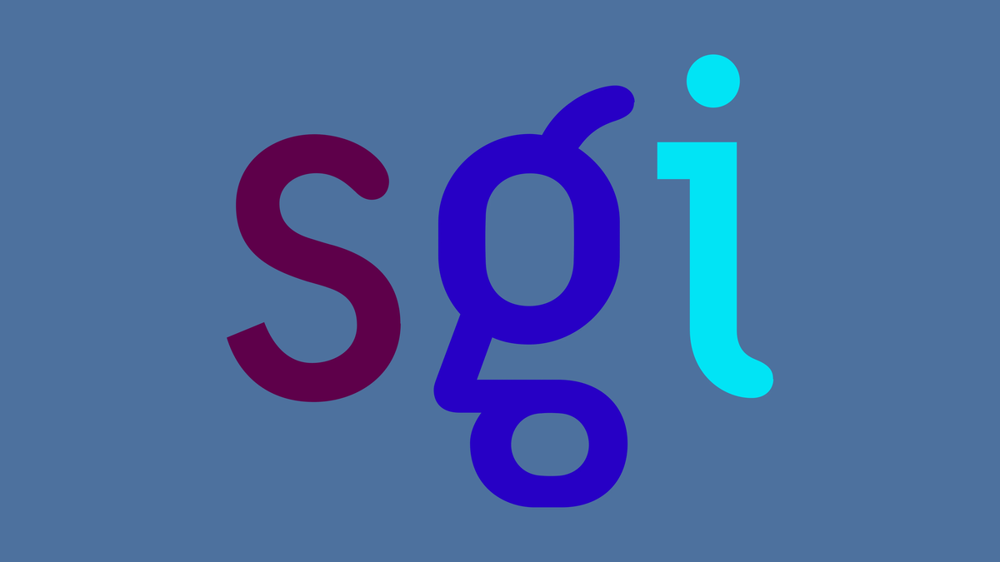

# SGI Irix

A light Indigo Magic theme for [Omarchy](https://omarchy.org), in the colors of an SGI IRIX desktop from the O2 years.

The theme menu shows it as **Sgi Irix**.



## Install

```bash
omarchy theme install https://github.com/rlimberger/omarchy-sgi-irix-theme
```

The same URL works from the Omarchy menu: **Install > Style > Theme**.

## What's in it

`colors.toml` is Motif chrome (`#D5D5D3`) on the IRIX desk, with the Icon Catalog blue as the selection color. `icons.theme` is `Yaru-blue`.

Backgrounds:

- `1-logo-desk.webp` — the 1999 sgi wordmark on desk blue `#4C719E`
- `2-logo-case.webp` — the same wordmark on the O2+ case purple `#52447C`

Cycle them with `omarchy theme bg next`.

## Credits

The wordmark is [Silicon Graphics (sgi) tricolour logo.svg](https://commons.wikimedia.org/wiki/File:Silicon_Graphics_(sgi)_tricolour_logo.svg) from Wikimedia Commons, used here as a simple lettering mark. sgi and Silicon Graphics are trademarks of their owners. This theme is not affiliated with Silicon Graphics or HPE.

The IRIX pattern tiles (Sprinkle, Tide Pool, Swirl, Scatter, Granite, Nebula, Luna Pearl, Rhodo) are Silicon Graphics artwork. A public mirror, [rann01/IRIX-tiles](https://github.com/rann01/IRIX-tiles), ships them with no license. The cube lockups are in [jujum4n/sgi-enhanced](https://github.com/jujum4n/sgi-enhanced), whose README names the GPL and also says the original design is copyright Silicon Graphics, and the repo has no LICENSE file. Those images are not included here.
